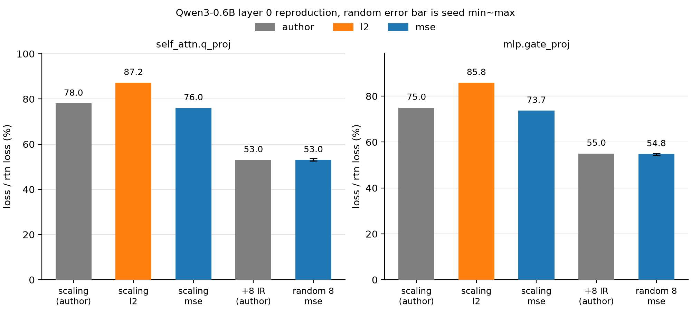
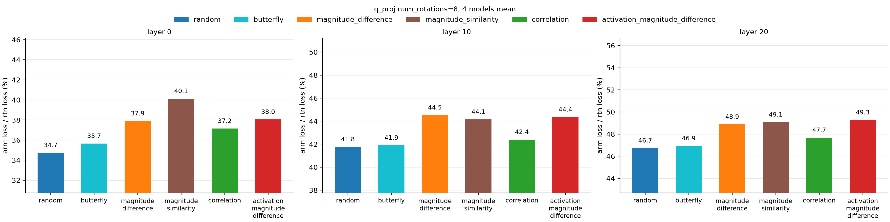
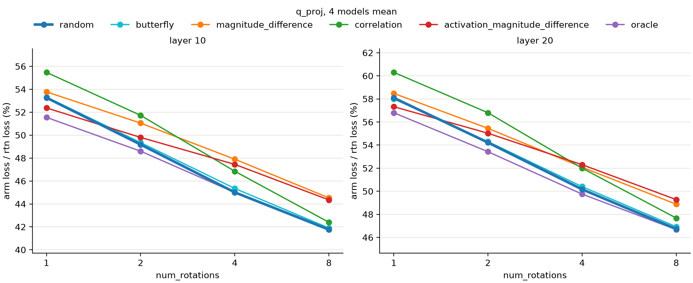
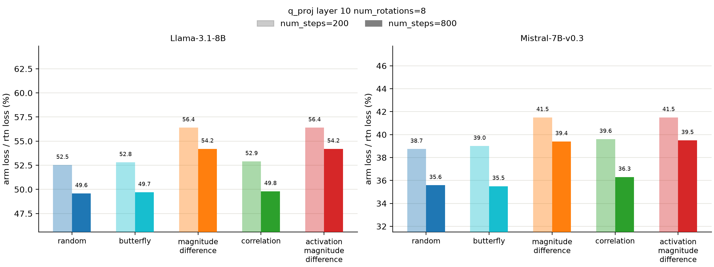
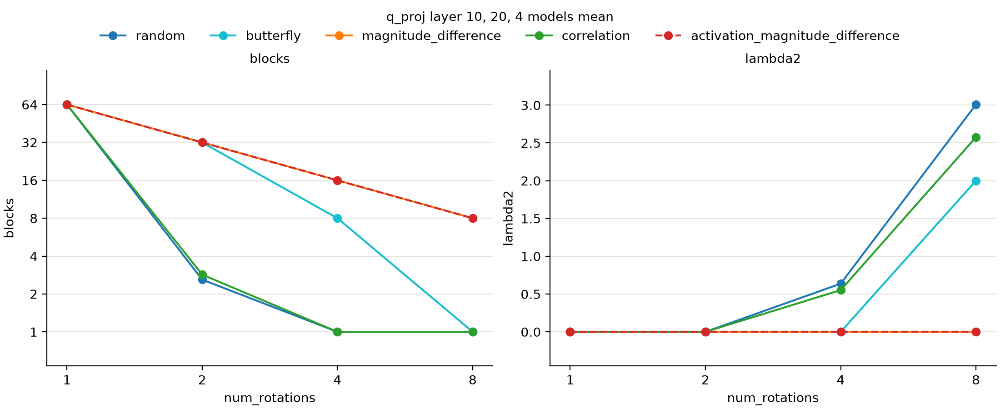
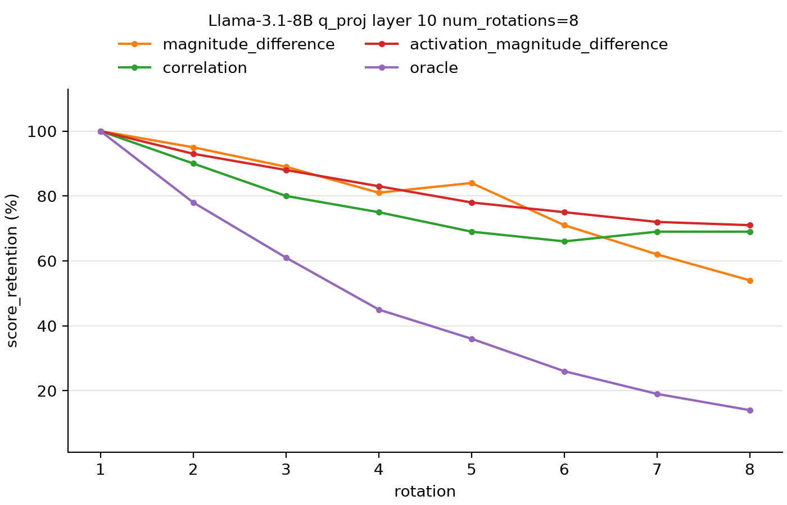
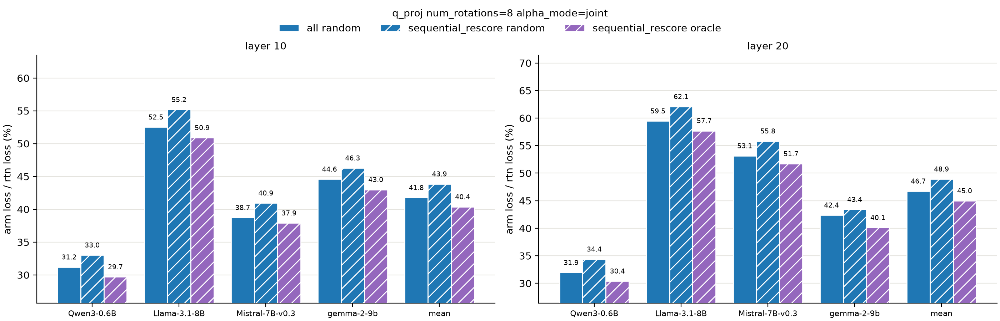
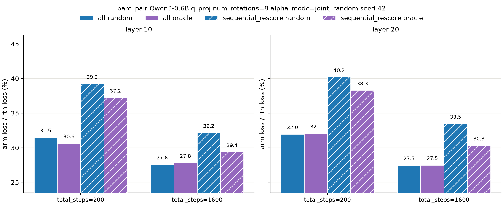

# paroquant pair selection

## 배경

[paroquant](https://arxiv.org/abs/2511.10645)는 group 안 channel을 둘씩 pair로 묶어 givens rotation을 걸고 그 각도를 학습해 양자화 오차를 줄임. 논문의 motivation은 outlier channel과 normal channel을 pair로 묶는 것이 효과적이라고 함. 하지만 A.1 알고리즘과 [현행 구현](https://github.com/z-lab/paroquant/blob/legacy/paroquant/optimize.py)은 pair를 random으로 고름.

[open review 답변](https://openreview.net/forum?id=1USeVjsKau)에서 저자는 한 rotation 안의 pair끼리 channel을 공유하지 않는 independent rotation이기만 하면 pair 선별 기준에 robust하다고 함. 원래 greedy였던 pair 선별도 단순함을 위해 random으로 바꿨다고 밝힘. 이 주장을 검증함.

## 요약

- robust하다는 주장과 달리 pair 선별 기준에 따라 loss가 달라짐.
- 크기 차이 arm은 rotation을 쌓을수록 random보다 나빠짐.
- 연결성과 학습 부족은 이 차이의 원인이 아님.
- 처음 매긴 pair 점수는 rotation을 쌓을수록 낮아짐. 다만 이것만으로 차이가 설명되지는 않음.
- range를 직접 보는 oracle은 rotation 1개에서 가장 좋음. 다만 rotation을 쌓을수록 이득이 사라짐.
- rotation마다 다시 고르고 하나씩 학습하면 현행 구현보다 좋음. 다만 학습량을 맞추면 현행 구현이 이김.

## 한계

- 대부분 q_proj, layer 10, 20, 4비트, group size 128만 봄.
- loss는 linear 하나의 출력 오차임. 모델 전체의 ppl은 보지 않음.
- oracle은 pair마다 따로 각도 16개를 grid search해 잰 근사임.
- correlation만 방향이 반대인 이유는 확인하지 않음.
- 모든 수치는 이 프로젝트의 이전 구현과 비공개 레포 paro_pair의 [로그](./logs/legacy)에서 가져옴.
- 학습량을 맞춘 비교는 paro_pair 로그로 qwen3 0.6b와 seed 하나로만 봄.

## 저자 환경이 재현되는지

### 실험 설정

open review 답변 Q4의 표를 재현함. qwen3 0.6b layer 0의 q_proj, gate_proj에서 두 가지를 봄. alpha만 학습한 scaling과 여기에 independent rotation 8개를 더한 +8 IR임(저자 값 78, 75와 53, 55).

loss는 linear 하나의 출력 오차를 rtn의 출력 오차로 나눈 %로 나타냄. 설정은 A.2를 따라 4비트 asymmetric min-max, group size 128, adamw learning rate 0.01, 200 step임. calibration만 pile 1024 토큰 16개로 줄임(논문 128개). random은 seed 5개.

### 결과

A.2 표기인 l2로 재면 scaling이 저자 값보다 9%p 넘게 높음(87.2%, 85.8%). mse로 재면 2%p 안으로 들어옴(76.0%, 73.7%). +8 IR은 저자 값이 seed 5개 범위 안에 있음(52.6~53.7%, 54.2~55.1%).

> 저자 표의 지표는 mse이고 mse로는 재현됨. 이후 loss는 모두 mse.

## pair 선별 기준과 무관한지

### 실험 설정

pair 선별 기준만 바꿈. 각 기준을 arm이라 부름.

| arm | 설명 |
| --- | --- |
| random | 섞어서 고름. 현행 구현. |
| butterfly | FFT의 butterfly 패턴으로 묶음. random도 정렬도 아닌 결정론적 통제군. |
| magnitude_difference | 두 channel의 weight 크기 차이가 큰 순서. 논문 motivation. |
| magnitude_similarity | 두 channel의 weight 크기 차이가 작은 순서. motivation의 반대. |
| correlation | 두 channel의 weight 상관계수 절댓값이 큰 순서. |
| activation_magnitude_difference | 두 channel의 weight 크기에 입력 크기를 곱한 차이가 큰 순서. |
| oracle | range를 가장 많이 줄이는 순서. 뒤에서 다룸. |

random과 butterfly를 뺀 넷은 점수 순서대로 고르므로 정렬 arm이라 부름. 그중 magnitude_difference와 activation_magnitude_difference는 크기 차이 arm이라 부름.

모델은 qwen3 0.6b, llama 3.1 8b, mistral 7b v0.3, gemma 2 9b의 q_proj. 이미 쓴 pair를 건너뛰다 채우지 못한 자리는 rotation하지 않는 dummy로 둠. random은 seed 평균을 먼저 냄. 값은 모델 4개의 평균임.

magnitude_similarity는 dummy가 많아 pair 선별 탓인지 rotation을 덜 한 탓인지 구분되지 않음. 그래서 이후 그림에서 뺌.

학습이 부족한 탓인지 보려고 llama 3.1 8b, mistral 7b v0.3의 layer 10에서는 800 step도 봄.

### 결과

rotation 8개에서 정렬 arm 넷은 모든 layer에서 random보다 나쁨(layer 10, 20에서 42.4~44.5%, 47.7~49.3% 대 41.8%, 46.7%). butterfly는 layer 10, 20에서 random과 거의 같음(41.9%, 46.9%). layer 0은 arm 간 편차가 커서 이후는 layer 10, 20만 봄.

rotation 1개에서는 activation_magnitude_difference가 random보다 좋음(layer 10, 20에서 52.4%, 57.3% 대 53.3%, 58.1%). rotation을 쌓을수록 크기 차이 arm은 random보다 나빠짐(rotation 8개 layer 10, 20에서 44.4~44.5%, 48.9~49.3% 대 41.8%, 46.7%). correlation만 반대로 random과의 차이가 좁혀짐(layer 10, 20에서 2.2%p→0.6%p, 2.2%p→1.0%p).

800 step으로 늘려도 크기 차이 arm과 random의 차이는 오히려 커짐(llama 3.9%p→4.6%p, mistral 2.8%p→3.8~3.9%p).

> robust하다는 주장과 달리 pair 선별 기준에 따라 loss가 달라짐. 크기 차이 arm은 rotation을 쌓을수록 나빠지고 학습을 늘려도 차이가 줄지 않음.

## 연결성이 차이를 설명하는지

### 실험 설정

arm 간 loss 차이가 연결성에서 오는지 봄. 연결성은 pair들이 channel을 간접적으로 연결하는 정도임. 모든 rotation의 pair를 하나의 그래프로 겹치고 rotation하지 않는 dummy는 뺌.

| 지표 | 설명 |
| --- | --- |
| blocks | group당 connected component 수. 1이면 group 안 channel이 모두 연결됨. |
| lambda2 | laplacian의 두 번째로 작은 고유값. 0이면 끊겨 있고 클수록 강하게 연결됨. |

### 결과

연결성이 모두 같은 rotation 1개에도 arm 간 loss가 달라짐(layer 10, 20에서 52.4~55.5%, 57.3~60.3%). rotation 2개에서는 random만큼 연결된 correlation이 가장 나쁨(layer 10, 20에서 51.7%, 56.8% 대 random 49.2%, 54.2%).

> 연결성은 arm 간 loss 차이를 설명하지 못함.

## 처음 매긴 pair 점수가 유지되는지

### 실험 설정

정렬 arm은 원본 weight로 pair 점수를 한 번만 매김. 앞선 rotation이 weight를 바꾸면 이 점수가 맞지 않을 수 있음. 그래서 llama 3.1 8b layer 10에서 rotation마다 pair 점수를 다시 잼.

score_retention은 같은 pair의 점수를 실제 rotation 시점에 잰 값과 rotation 전에 잰 값의 비임. 앞선 rotation 뒤에 점수가 얼마나 낮아졌는지 봄.

### 결과

8번째 rotation 시점에는 정렬 arm의 score_retention이 rotation 전보다 낮아짐(54~71%). 그런데 크기 차이 arm 둘은 score_retention이 크게 다르지만(54%, 71%) loss는 같음(56.4%). 점수가 낮아진 정도로는 arm 간 차이가 설명되지 않음.

> 처음 매긴 pair 점수는 rotation을 쌓을수록 낮아짐. 다만 이것만으로 arm 간 차이가 설명되지는 않음.

## range를 직접 보고 고르면 나은지

### 실험 설정

앞의 정렬 arm은 모두 직감으로 정한 점수임. range를 실제로 가장 많이 줄이는 pair를 고르는지는 모름. 그래서 oracle을 더함. oracle은 pair마다 각도 16개를 grid search하고 range를 가장 많이 줄인 감소량을 점수로 씀. 나머지는 앞과 같음.

### 결과

[앞선 그림](#pair-선별-기준과-무관한지)에서 oracle은 rotation 1개일 때 가장 좋음(layer 10, 20에서 51.6%, 56.8% 대 random 53.3%, 58.1%). 하지만 rotation을 쌓을수록 이득이 사라짐(rotation 8개 layer 10, 20에서 41.8%, 46.7%로 random과 같음).

[앞선 pair 점수 그림](#처음-매긴-pair-점수가-유지되는지)에서 oracle의 score_retention도 다른 정렬 arm보다 훨씬 빨리 낮아짐(8번째 rotation 14% 대 54~71%).

> range를 직접 보고 고르면 이득이 있음. 다만 처음 매긴 점수가 rotation을 쌓을수록 낮아져 이득이 사라짐.

## rotation마다 다시 고르면 이득이 남는지

### 실험 설정

rotation마다 다시 고르려면 앞선 rotation이 반영된 weight로 점수를 매겨야 함. 그래서 theta도 하나씩 순차로 학습해야 함.

| schedule | 점수를 매기는 시점 | theta 학습 |
| --- | --- | --- |
| all | 처음 한 번 | 한꺼번에. 현행 구현. |
| sequential_rescore | rotation마다 | 앞선 rotation을 고정하고 하나씩 |

sequential_rescore는 rotation 하나당 200 step을 학습함. rotation 8개면 총 1600 step임.

학습량을 맞춘 비교는 paro_pair의 로그로 봄. 구현이 달라 숫자가 조금 다르므로 그 안에서만 비교함. qwen3 0.6b layer 10, 20에서 rotation 8개, random seed 42 하나로 봄.

### 결과

sequential_rescore oracle은 모델 4개, layer 2개의 8개 조합 모두에서 현행 구현보다 좋음(layer 10, 20 평균 40.4%, 45.0% 대 41.8%, 46.7%). 같은 방식의 random은 오히려 나쁨(43.9%, 48.9%).

그러나 all도 1600 step으로 늘리면 random이 sequential_rescore oracle보다 좋음(layer 10, 20에서 27.6%, 27.5% 대 29.4%, 30.3%).

> rotation마다 다시 고르고 하나씩 학습하면 현행 구현보다 좋음. 다만 학습량을 맞추면 현행 구현이 이김.
